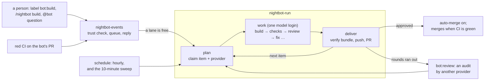

# How the night bot works

## The pieces

| Piece | Where | Holds | Does |
|---|---|---|---|
| `nightbot-events.yml` | GitHub's runner, on every comment, label, review, CI result, and every 10 minutes | the bot's token | answers commands, queues work, starts runs; the sweep releases lost runs and rewrites the status issue |
| `nightbot-run.yml` `plan` | GitHub's runner | the bot's token, **no model** | picks the next item and provider, claims both, writes `plan.json` |
| `nightbot-run.yml` `work` | the provider's `runs_on`: GitHub's runner or your machine | **one** model login, a read-only token | the model builds, the checks run, a fresh session reviews, the model fixes; leaves `result.json` and a git bundle |
| `nightbot-run.yml` `deliver` | GitHub's runner | the bot's token, **no model** | verifies the bundle, pushes, opens the pull request, comments, labels, turns on auto-merge, starts the next run |
| `_nightbot-state` branch | GitHub | `state.json` | what the bot remembers (below) |
| `harness/` | the repository | Go, standard library only | the `nightbot` binary every job runs |

The model never holds a token that can write to GitHub, and the jobs that can write never run a
model. That split is the core of the design ([`security.md`](security.md)).

## One run, step by step

1. **Plan.** The planner reads the state and the queue (open issues and pull requests carrying
   `bot:build`, `bot:revise` or `bot:review`, and the questions in the state). Each provider is
   *available* if it is enabled, not suspended or parked, inside its hours, under its minute
   caps, has its secret set, and has a lane its runs do not hold. Each item needs a tier: weak for
   questions and triage, medium for a medium item, strong for a hard one. The planner walks the
   queue in order and gives the first item it can place to the provider whose **weakest model
   that is strong enough** is the weakest (cheap models for cheap work, strong ones kept for hard
   items), ties going to the `priority` order. It records the claim in the state (compare-and-set,
   and the plan job is serialized, so two runs never claim one item), labels the item
   `bot:building`, reads the item's text and its trusted people's comments, and writes `plan.json`.
2. **Work.** On the provider's runner, with only that provider's login:
   - **build**: the model works on the item's branch. The harness folds whatever it changed into
     one commit, after putting back any change to a `forbidden_paths` file.
   - **checks**: each `checks` command runs with a clean environment (no tokens). Red checks go
     back to the model, up to `fix_passes` times.
   - **review**: a fresh, read-only session of the same model gets the task, the builder's
     report, the checks and the diff, and must end with a JSON verdict. The harness discards
     anything a read-only session changes. Blocking findings go back to the builder, then the
     checks run and it reviews again, up to `review_rounds` for the item's difficulty.
   - **revise** starts from the request (a person's ask, review findings, or CI's failed jobs'
     logs); **ask** and **triage** are single read-only calls on a weak model.
   - It writes `result.json` and, when there is a change, `change.bundle`.
3. **Deliver.** Back on GitHub's runner with the bot's token: it verifies the bundle against the
   repository, refuses any change to a forbidden path, to a branch not the bot's own, or one that
   does not move the branch forward, turns auto-merge off on a pull request it is about to change,
   pushes, and opens (or updates) the pull request. Auto-merge goes on only for the commit the
   review approved. Then it ships, queues an audit, or
   hands the item to a person ([README](../README.md#what-happens-to-a-change)). It books the run's
   model minutes, parks a provider that was refused for usage limits until the reset time the
   refusal named, releases the claim and starts the next run when a lane is free.

A run whose work job is cut off (a refusal, the job's time budget) keeps its work: deliver pushes
the branch without opening a pull request, and the next build of the item carries it on.

## What the bot remembers

`state.json` on the `_nightbot-state` branch, written compare-and-set through the contents API so
overlapping handlers never lose each other's writes:

| Field | What |
|---|---|
| `halted`, `suspended`, `parked` | the off switches, and providers waiting for a usage reset |
| `running` | each claim: item, action, provider, model, run id, start |
| `usage` | each provider's model minutes over the last seven days, for the `limits` caps |
| `items` | per issue or pull request: failures, its pull request or issue, branch, difficulty, the notes a revision must answer, CI fixes, audits |
| `queries` | questions waiting for an answer |
| `history` | the last 100 runs, for the status issue |
| `handled` | comment and review ids already answered, so a redelivered event does nothing twice |

The sweep releases a claim whose run ended without delivering (counting a failure), so a crashed
run never holds an item for good. Editing the file by hand is safe while no run is going.

## Events it answers

| Event | Answer |
|---|---|
| a comment with `/nightbot …` or a mention, from a trusted person | the command ([README](../README.md#commands)) |
| `bot:build` added to an issue | a reply with its place in the queue, and a run if a lane is free |
| the issue assigned to the bot | `bot:build` |
| a trusted person requests changes on the bot's pull request | a revision with the review's text |
| `ci_workflow` fails on the bot's pull request's head | a revision with the failed jobs' logs, up to `max_ci_fixes` |
| `ci_workflow` fails on its entry in the merge queue (`gh-readonly-queue/…`) | a revision that merges the newest default branch in first, then fixes what failed |
| (the sweep) the bot's pull request conflicts with the default branch | a revision that merges the default branch in, the model resolving the conflicts |
| the bot's pull request closes | the item's memory cleared; merged ones go in the history |
| the schedule | the sweep |

## Fork mode and the plan gate

With `plan_gate`, every item is planned first and built only once an approver approves the plan.
In fork mode the repository the bot is installed in holds the queue, and the bot builds on its
fork of another repository: its changes go through the fork's CI into a sandbox, then upstream
for a person to merge, and the sweep follows each upstream pull request, since that repository
sends this one no events. [`fork-mode.md`](fork-mode.md) has the whole flow.
