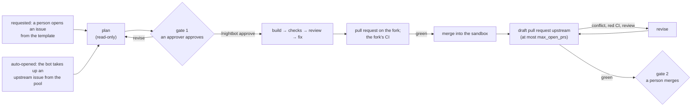

# Fork mode and the plan gate

Two settings change how work reaches a repository:

- **The plan gate** (`"plan_gate": true`): nothing is built until a person approves a plan for
  it. Works on its own, in the repository the bot is installed in.
- **Fork mode** (`"upstream": {…}`): the bot works on a repository it does not own. This
  repository holds the queue, the plans and the status issue; the bot builds on its own fork of
  the other repository and delivers there by pull request, which a person merges. Fork mode needs
  the plan gate.

## The flow



1. **Intake.** An item is an issue here, with one of two labels:
   - `requested`: a person opened it, usually from the request template, with a link to the
     upstream issue. A trusted person's request is queued to plan at once; anyone else's waits
     for a trusted person's `/nightbot plan`.
   - `auto-opened`: the sweep took up an upstream issue from the pool by itself, while fewer
     than `auto_open.max_open` (two by default) of its own are open here. The pool is the open
     upstream issues carrying one of `auto_open.labels`, and with `auto_open.assigned` those
     assigned to the bot. Each upstream issue is taken up once.

   The bot comments on the upstream issue to say where it is taken up.
2. **Plan.** A read-only call reads the code and the upstream issue and writes a plan: summary,
   diagnosis with `path:line` citations, approach, steps, tests, acceptance criteria, touched
   paths, risks and open questions. It goes up as a draft pull request here adding
   `plans/<number>-<slug>.md` (`plans_dir`), and the issue is labelled `bot:awaiting-approval`.
3. **Gate 1.** An approver (`approvers`, or the operator) comments `/nightbot approve` on the
   plan's pull request or on the issue, or approves the pull request in a review. The plan as it
   stands at that moment, edits a person pushed to it included, is what the build follows; the
   pull request merges, so `plans/` keeps every approved plan. `/nightbot revise <what to change>`
   has the plan rewritten instead, and `/nightbot reject` or closing the pull request turns the
   work down (`human`).
4. **Build.** The model works on `nightbot/<number>-<slug>`, cut from upstream's default branch,
   with the approved plan in its prompt. The checks run, a fresh session reviews the change
   against the task and the plan, and the builder fixes what it finds. Deliver pushes the branch
   to the fork and opens a pull request there into the sandbox.
5. **The sandbox.** The fork's branch named like upstream's default branch is the sandbox: upstream
   plus the bot's approved, CI-green changes, for people to try before they merge anything. The
   sweep merges the fork's pull request (`fork_merge_method`) once the fork's CI is green at the
   head the review approved, or once no check has reported on that head for `no_ci_minutes`. A
   change that conflicts with the sandbox skips it and goes upstream anyway. Every sweep syncs the
   sandbox with upstream; one that no longer merges is reset to upstream (what it held is still
   on its branches and pull requests).
6. **Upstream.** A draft pull request opens upstream from the fork's branch while fewer than
   `max_open_prs` of the bot's pull requests are open there, its earlier ones included; until
   then the change waits in the fork. The sweep follows it every ten minutes:
   - a conflict with upstream's default branch queues a revision that merges it in (a real merge
     commit; the model resolves the conflicts);
   - red CI queues a fix with the failing jobs' logs, once for each head, up to `max_ci_fixes`;
   - a trusted person's changes-requested review, `/nightbot revise <change>` comment or mention
     queues a revision; `/nightbot stop` stops the item;
   - once CI is green and it merges cleanly, it is marked ready, `reviewers` are asked, and it
     says so.
7. **Gate 2.** A person merges it upstream. The item closes here and the status issue counts it.
   A pull request a person closes unmerged hands the item to a person (`human`).

The bot never merges upstream: the upstream client is made unable to (`ErrMergeForbidden`), and
nothing else merges there. It merges only plans here and changes into its own fork's sandbox.

## Labels

| Label | Meaning |
|---|---|
| `requested` | an item a person asked for |
| `auto-opened` | an item the bot took up from upstream by itself |
| `bot:plan` | queued to be planned (again, after `revise`) |
| `bot:awaiting-approval` | its plan waits for an approver (gate 1) |
| `bot:plan-pr` | a plan's pull request |
| `bot:build` | approved and queued to build |
| `bot:revise` | queued for a revision of its branch |
| `human` | the bot keeps off it: turned down, stopped, out of fixes, or closed upstream |

## Commands

On an issue here or its plan's pull request, from someone on the trust list:

| Command | What it does |
|---|---|
| `/nightbot plan [link]` | queue this issue to be planned, for the upstream issue the link (or the issue) names |
| `/nightbot approve` | approve the plan (approvers only) |
| `/nightbot reject [why]` | turn the plan down (approvers only) |
| `/nightbot revise <change>` | rewrite a plan that waits for approval; once built, revise the work |
| `/nightbot build` | before approval, the same as `plan`; after, start a build |
| `/nightbot stop` | take it out of the queue and keep the sweep off it (`human`) |
| `/nightbot rebuild` | start over from the approved plan: its fork branch goes, its upstream pull request closes |

On the bot's upstream pull request, the sweep reads `/nightbot revise <change>`, a mention of
the bot, a changes-requested review and `/nightbot stop` from people on the trust list.

## The status issue

With the plan gate, the status issue gains a **Pipeline** table (merged upstream in the last 7 and
30 days, the bot's items open upstream against `max_open_prs`, the sandbox's last sync) and an
**Items** table: each item's intake, stage, what it waits on, its plan, fork and upstream pull
requests, and how long it has been in its stage. The stages are `planning`, `awaiting approval`,
`approved`, `fork CI`, `held in the fork`, `upstream CI`, `in review`, `revising`, `with a person`
and `closed`.

## Setting it up

1. Fork the upstream repository with the bot's account, and enable Actions on the fork so the
   upstream repository's own CI runs on the fork's pull requests.
2. In `config.json`: `"plan_gate": true`, `"approvers"`, and

   ```json
   "upstream": {
     "repo": "upstream-owner/product",
     "fork": "bot-account/product",
     "max_open_prs": 2,
     "reviewers": ["a-maintainer"],
     "auto_open": { "labels": ["bot-ok"], "assigned": true, "max_open": 2 }
   }
   ```

   `checks` are the product's own commands, run in its clone; the toolchain steps in
   `nightbot-run.yml` work in `$NIGHTBOT_PRODUCT`.
3. The bot's token is a bot account's classic token with `public_repo` (it pushes to its own fork,
   opens pull requests upstream and here, and comments) and `workflow` if upstream's changes touch
   `.github/` (the sandbox's sync carries them). The upstream repository and the fork must be
   public: the model job clones them without a token.
4. `nightbot setup --repo-settings` keeps the fork from deleting a branch when it merges one into
   the sandbox, which the upstream pull request still needs. `nightbot doctor` checks the fork's
   parent, that setting, and that the token reads upstream.
5. `install.sh --upstream OWNER/NAME --fork OWNER/NAME` writes the config above and adds the
   request template, `.github/ISSUE_TEMPLATE/nightbot-request.yml`.
