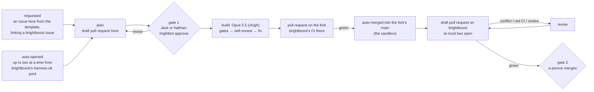

# bright-bots-harness

The night bot for [`Bright-Bots-Initiative/brightboost`](https://github.com/Bright-Bots-Initiative/brightboost).
It takes an issue there to a reviewed, CI-green pull request, with a person deciding twice:
whether the plan is built, and whether the result merges. It is an install of
[Night-Bot-Scaffolding](https://github.com/Jlore-Studios/Night-Bot-Scaffolding) in **fork mode**:
this repository holds the queue, the plans and the status issue; the bot builds on its fork
[`jgoetzmann-bot/brightboost`](https://github.com/jgoetzmann-bot/brightboost) and delivers upstream.
One Go binary, standard library only, run by GitHub Actions as the account `jgoetzmann-bot`.

## The flow



| Step | What happens | Where you see it |
|---|---|---|
| Intake | An issue here labelled `requested` (a person opened it from the request template with a brightboost issue link) or `auto-opened` (the bot took up a brightboost issue labelled `harness-ok`, or assigned to `jgoetzmann-bot`, while fewer than two of its own are open). The bot comments on the brightboost issue to say where it is taken up | An issue here; a comment on the brightboost issue |
| Plan | Opus 5.5 reads the code and the issue and writes a plan: diagnosis with `path:line` citations, approach, steps, tests, acceptance criteria, touched paths, risks, open questions | A draft pull request here adding `plans/<n>-<slug>.md` |
| Gate 1 | Jack or Nathan approves the plan's pull request in a review (which can let it merge into `plans/`, since `main` needs an approving review), or comments `/nightbot approve` on it (the approval counts the same; the pull request closes with the plan kept on its branch). `/nightbot revise <what to change>` has it rewritten; `/nightbot reject` or closing it turns the work down. Nothing is built before this | The plan's pull request |
| Build | Opus 5.5 at xhigh effort builds on `nightbot/<n>-<slug>`, cut from brightboost's `main`, following the approved plan. Brightboost's gates run (`npm ci`, `npx prisma generate`, lint, typecheck, the backend typecheck, the prisma drift check, `test:unit`, `build`), first on the untouched base and then after the change: only a gate the change turned red blocks it, and the builder fixes those (the drift check needs a database the runner lacks, so it is red on the base). A fresh, read-only session reviews the diff adversarially against the issue and the plan; the builder fixes what it finds, up to four rounds (six for `difficulty:hard`) | Commits on the fork |
| The fork | A pull request on the fork into its `main`. When brightboost's own CI is green there, at the head the review approved, the bot merges it: the fork's `main` is a sandbox holding brightboost plus every approved, green change, for trying games with a keyboard before anything merges upstream | A pull request on `jgoetzmann-bot/brightboost` |
| Upstream | A draft pull request on brightboost from the fork's branch, while fewer than two of the bot's pull requests are open there (the old harness's still-open ones count); until then the change waits in the fork. Every ten minutes the bot checks it: a conflict with `main` gets `main` merged in (the model resolves it), red CI gets fixed from the failing jobs' logs, and a changes-requested review or `/nightbot revise` from Jack or Nathan gets a revision. Once CI is green and it merges cleanly, it is marked ready and asks Jack and Nathan for review | A pull request on `Bright-Bots-Initiative/brightboost` |
| Gate 2 | A person merges it upstream. The bot never merges there: its upstream client refuses to | The upstream pull request |

## The tracker

The pinned **Harness status** issue is rewritten every ten minutes: what is running, each item's
stage (`planning`, `awaiting approval`, `fork CI`, `held in the fork`, `upstream CI`, `in review`,
`revising`, …) and what it waits on, links to its plan, fork and upstream pull requests, how long it
has been in its stage, how many changes merged upstream in the last 7 and 30 days, the queue, and the
last runs. `/nightbot status` on any issue prints the same.

## Giving it work

Open an issue with **Request work from the night bot** and paste the brightboost issue's link. From
Jack or Nathan it is queued to plan at once; anyone else's waits for one of them to comment
`/nightbot plan`. The bot also takes up brightboost issues labelled `harness-ok` (and ones assigned
to `jgoetzmann-bot`) by itself, two at a time.

| Command | What it does |
|---|---|
| `/nightbot plan [link]` | plan this issue (for the brightboost issue the link names) |
| `/nightbot approve` | approve the plan: gate 1 (Jack or Nathan) |
| `/nightbot reject [why]` | turn the plan down |
| `/nightbot revise <change>` | rewrite a plan waiting for approval; once built, revise the work (also on the upstream pull request) |
| `/nightbot ask <question>` | a question about brightboost's code |
| `/nightbot stop` / `rebuild` | stop an item / start it over from its approved plan |
| `/nightbot status` / `help` | the tracker / every command |
| `/nightbot halt` / `start` | stop starting runs / start again |

[`.nightbot/README.md`](.nightbot/README.md) is the operating guide and
[`.nightbot/docs/fork-mode.md`](.nightbot/docs/fork-mode.md) the whole flow.

## Hours and the subscription

The Claude subscription is shared with the JackiOh night bot. Builds and revisions start only from
01:30 to 06:30 UTC (`claude-night`), before JackiOh's hours; plans and questions run from 13:00 to
23:00 UTC (`claude-day`), so a plan written in the day is up for approval before that night's
window. Both are Opus 5.5 (`claude-opus-5-5`) at xhigh effort, one run at a time, and a usage-limit
refusal parks the subscription until the reset it names. `/nightbot build --force` from Jack starts
a build outside the window. The hours are in [`.nightbot/providers.json`](.nightbot/providers.json).

## Stopping it

| To stop | Do |
|---|---|
| every new run | `/nightbot halt` (undo: `/nightbot start`) |
| everything, in a way no comment can undo | commit `.nightbot/HALT` |
| one item | `/nightbot stop`, or label it `human` |

## Setting it up (once)

1. **Secrets.** `CLAUDE_CODE_OAUTH_TOKEN` (already set), and the bot's token: the workflows read
   `NIGHTBOT_GITHUB_TOKEN`, or the existing `HARNESS_GITHUB_TOKEN` when that is unset. It is
   `jgoetzmann-bot`'s classic token with `public_repo` and `workflow`.
2. **The fork.** Enable Actions on `jgoetzmann-bot/brightboost` (Actions → "I understand my
   workflows, go ahead and enable them"), so brightboost's CI runs on the bot's pull requests there.
3. **Labels, the state branch and the fork's settings**, with `jgoetzmann-bot`'s token (it owns
   the fork and can write here):

   ```bash
   cd .nightbot/harness
   export NIGHTBOT_GITHUB_TOKEN=...   # jgoetzmann-bot's token, the same as the HARNESS_GITHUB_TOKEN secret
   go run ./cmd/nightbot setup --repo-settings
   go run ./cmd/nightbot doctor
   ```

   `setup --repo-settings` makes the fork keep a branch when it merges one into the sandbox, since
   the upstream pull request still needs it; `doctor` says what is still missing.
4. **This repository is public**, so allow `pull_request_target` for
   `.github/workflows/nightbot-events.yml` alone in Settings → Actions → General: from 2026-12-02
   GitHub blocks it unless a policy allows it, and without it the bot never hears a plan's pull
   request close.
5. **Pin the status issue** once the first sweep opens it.

## Where things are

| Path | What |
|---|---|
| `.nightbot/config.json` | the repositories, the gates, the approvers, the caps |
| `.nightbot/providers.json` | the model, its effort and its hours |
| `.nightbot/trust.txt` | who may command the bot (`jgoetzmann` is the operator) |
| `.nightbot/prompts/` | what the model is asked, verbatim |
| `.nightbot/harness/` | the harness: Go, standard library only, with its tests |
| `.github/workflows/nightbot-*.yml` | events (every command, label and the ten-minute sweep), runs (plan → work → deliver), selftest |
| `.github/ISSUE_TEMPLATE/nightbot-request.yml` | the request template |
| `plans/` | the approved plans whose pull requests merged |
| [`DECISIONS.md`](DECISIONS.md) | why it is the way it is |

The Python harness this replaced is in the history up to `ce13f23`.
